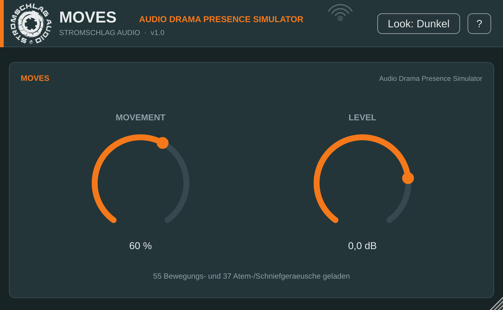
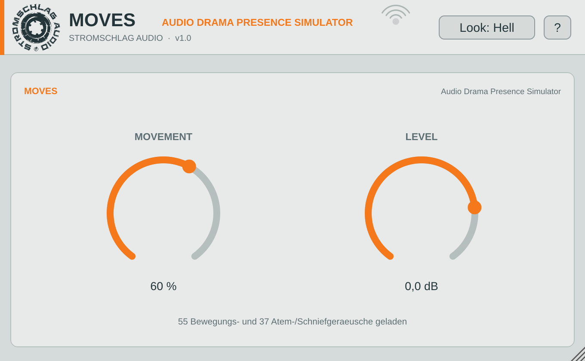

# MOVES – Dezente Bewegungs- und Atemgeräusche


VST3-Effekt für Hörspiel-Produktion, der ganz ohne Eingangssignal auskommt. Er erzeugt selbstständig die
fast unhörbaren, unwillkürlichen Bewegungsgeräusche eines anwesenden Menschen: minimale Gewichtsverlagerungen,
dezentes Kleidungsrascheln, sehr selten ein leiser Atemhauch – als dünne, unregelmäßige Folge einzelner
Ereignisse, nicht als Dauergeräusch.

**⬇ Download (Windows · VST3):** https://github.com/StromschlagProductions/Moves-vst/releases/latest

## Warum es dieses Plugin gibt

Bei Hörspielproduktionen werden oft nur Sprache und bewusst gesetzte Foley-Geräusche verwendet. Besonders
ruhige Dialogszenen können dadurch unnatürlich steril wirken, weil die akustische Mikropräsenz einer
anwesenden Person fehlt – die kleinen, unwillkürlichen Geräusche, die niemand bewusst setzen würde, die aber
im echten Leben immer da sind.

MOVES legt genau diese Ebene unter die Szene. Es ist kein Foley-Sampler für deutlich wahrnehmbare Aktionen
(Schritte, Türen, Gegenstände) und kein Geräuschgenerator im klassischen Sinn, sondern ein sehr zurückhaltender
Präsenz-Simulator. Den besten Eindruck von seiner Wirkung bekommt man, wenn man ihn in einer laufenden Szene
kurz ausschaltet.

– Lars Eickstädt, Stromschlag Audio

**Aktuelle Version: 1.2** · [Änderungen und Prüfstand](docs/releases/1.2.md)

## Oberfläche

Oben links Logo und Name, rechts Dunkel/Hell und die Hilfe (**?**). Darunter die Ereignis-
und Pegelanzeige sowie eine kompakte Karte mit den beiden Reglern. Farbschema und
Fenstergröße (50–300 %) werden mit dem Projekt gespeichert.



<details>
<summary>Helle Oberfläche ansehen</summary>



</details>

## Regler (automatisierbar)

| Regler | Wirkung |
|---|---|
| **AKTIVITÄT** | Aktivität der simulierten Person. Niedrig: seltene Ereignisse, lange Ruhephasen, sehr dezent. Mittel: natürlich wirkende, gelegentliche Bewegungen – passend für die meisten Dialogszenen. Hoch: häufigere, lebhaftere Präsenz; einzelne Geräusche können sich deutlich überlagern. |
| **LAUTSTÄRKE** | Gesamtlautstärke der erzeugten Geräusche, −60 bis +12 dB (Standard −6 dB), feinstufig im unteren Bereich für sehr leise Hintergründe. |

Ein kleiner Teil der Ereignisse (deutlich seltener als Bewegungen, ohne regelmäßigen Atemrhythmus) ist ein
sehr leiser Atemhauch oder ein Nasengeräusch.

## Anzeige und weiche Wiedergabe (ab 1.2)

Die Ereignisvorschau zeigt Bewegungen in Orange und Atem-/Nasengeräusche in gedämpftem
Grün. Die Positionsmarke folgt dem Host. Status und Ausgangsanzeige beruhen auf dem
tatsächlich verarbeiteten Audio; die Anzeige misst Spitzenpegel in dBFS, keine LUFS.
Bei Änderungen der Aktivität wird die Vorschau für den aktuellen Wert neu berechnet;
bereits laufende Geräusche klingen aus. Die Vorschau ist keine aufgezeichnete Historie.

Samples werden beim Laden intern behutsam im Pegel angeglichen. Bewegungen erhalten
einen aktiven RMS-Bezug von −30 dBFS, Atem-/Nasengeräusche von −36 dBFS. Gain ist auf
+36 dB und der Sample-Spitzenpegel auf −16 dBFS begrenzt. Kurze Impulse werden mit einer
vorausschauenden, geglätteten Hüllkurve abgeschwächt. Weiche Ein-/Ausblendungen schützen
Sample- und Ereignisränder. Die Originaldateien bleiben unverändert. Eine weiche
Ausgangskennlinie schützt vor hartem Clipping bei Überlagerungen und hohem Ausgangspegel.
Diese internen Werte sind keine Lautheitsnormierung des fertigen Hörspiels.

**Wichtig für alte Projekte:** 1.2 klingt bewusst anders. Wichtige ältere Szenen vor dem
Update als Audio sichern. Das Zustandsformat und die Parameter-IDs bleiben lesbar;
das stellt keine klangidentische Wiedergabe älterer Versionen sicher.

## Anwendung

1. MOVES auf eine eigene, leere Spur legen – kein Eingangssignal, keine MIDI-Noten nötig.
2. AKTIVITÄT passend zur Szene wählen (ruhiges Zweiergespräch: niedrig bis mittel; unruhigere Szene: höher).
3. LAUTSTÄRKE so leise einstellen, dass die Spur erst beim Abschalten auffällt.
4. Für mehrere Figuren ggf. mehrere Instanzen auf getrennten Spuren verwenden (jede neu angelegte Instanz erzeugt ihre eigene,
   unabhängige Ereignisfolge; das Duplizieren des vollständigen Zustands kopiert auch die Folge).

## Hinweise

- MOVES hat keinen Eingang: Die Spur läuft komplett über den Effekt, es gibt nichts durchzureichen. Im Bypass
  ist MOVES nach einem weichen 40-ms-Übergang stumm, sofern der Host den Plugin-Bypass aufruft.
- **Reproduzierbar:** Bei gleicher Projektposition und gleichen Reglerwerten entsteht immer dieselbe
  Ereignisfolge – ein zweiter Export derselben Szene klingt also nicht zufällig anders, auch nach einem Sprung
  mitten in die Szene oder bei Loop-Wiedergabe. Voraussetzung ist eine während der Wiedergabe gleichbleibende
  Abtastrate.
- Die Samplebibliothek ist fest eingebaut; es ist keine manuelle Ordnerverwaltung nötig. Details zur Herkunft
  und automatischen Aufbereitung der Aufnahmen: [docs/SAMPLES.md](docs/SAMPLES.md).

## Installation (Windows)

1. Über den Download-Link oben `Moves-VST3-Windows.zip` bzw. die Release-ZIP laden.
2. ZIP entpacken und den **ganzen Ordner** `Moves.vst3` nach `C:\Program Files\Common Files\VST3` kopieren.
3. DAW neu starten bzw. Plugins neu scannen. Zielumgebung: Studio One Pro 8 unter Windows; die eigene DAW-Abnahme ist separat erforderlich.

## Unterstützte Plattformen und Formate

Windows, VST3. 44,1 kHz und 48 kHz werden unterstützt; höhere Abtastraten laufen technisch mit, waren aber
keine Entwicklungspriorität für diese Version.

## Build-Anleitung

Voraussetzungen: CMake ≥ 3.22, ein C++17-Compiler, Internetzugang beim ersten Konfigurieren (JUCE wird per
FetchContent geladen, Version 8.0.9).

```
cmake -B build
cmake --build build --config Release
```

Nur die Klang-Engine bauen und testen (ohne JUCE, z. B. für schnelle Regressionstests unter Linux):

```
cmake -B build-dsp -DAUDIO_DSP_ONLY=ON
cmake --build build-dsp
ctest --test-dir build-dsp --output-on-failure
```

## Versionen

Die Versionsnummer steht in der Datei `VERSION`, im Plugin-Kopf und im Namen der Release. Versionsschema und
Release-Ablauf: [docs/VERSIONING.md](docs/VERSIONING.md).

- **1.1** – Der Plugin-Ordner heißt jetzt `Moves.vst3` (wie bei den anderen Plugins, vorher `MOVES.vst3`); Hilfetext mit richtigen Umlauten; Klang und gespeicherte Projekte unverändert. [Release-Hinweise](docs/releases/1.1.md).
- **1.2** – Neue Abstimmung, Anzeige und Funktionskorrekturen. [Details und Grenzen](docs/releases/1.2.md).
- **1.1** – Angepasste Schreibweise `Moves.vst3`, deutsche Hilfe.
- **1.0** – Erste Version. [Release-Hinweise](docs/releases/1.0.md).

## Aufbau

- `Source/MovesDSP.h`: Klang-Engine (reines C++). Positionsbasierte, deterministische Ereignisplanung
  (lokales Prioritätsraster statt fortlaufendem Zufallsgenerator) – siehe Kommentar am Dateianfang für die
  Reproduzierbarkeits-Begründung.
- `Source/PluginProcessor.*`, `Source/PluginEditor.*`: JUCE-Plugin, Samplebibliothek-Laden und Oberfläche.
- `Assets/samples/movements`, `Assets/samples/breaths_sniffs`: eingebettete Samplebibliothek, siehe
  [docs/SAMPLES.md](docs/SAMPLES.md).
- `.github/workflows/tests.yml`: Linux-DSP-Tests (ASan/UBSan) bei jedem Push.
- `.github/workflows/build.yml`: Windows-Bau, Regressionstests und pluginval; Releases nur nach explizitem
  Workflow-Start mit `publish`.

## Qualität und Prüfung

- **Automatische Tests der Klangberechnung** (`Tests/DSPTests.cpp`, ohne JUCE): keine Audio-Thread-Allokationen,
  Reproduzierbarkeit bei gleicher Position/gleichen Parametern unabhängig von der Blockgröße, Positions-
  Unabhängigkeit (ein direkter Sprung mitten in die Szene liefert dasselbe Ergebnis wie durchgehendes
  Abspielen), endliche/begrenzte Ausgabe auch bei Extremwerten, stummes und stabiles Verhalten ohne
  Samplebibliothek.
- **Prozessor-Tests** (`Tests/ProcessorTests.cpp`, mit JUCE): verschiedene Abtastraten/Blockgrößen/Bus-Layouts,
  Blockaufteilung ändert das Ergebnis nicht, Zustand speichern/wiederherstellen (inkl. defekter Daten),
  GUI-Lebenszyklus, mehrere gleichzeitige Instanzen.
- **Echtzeitsicher:** Während der Wiedergabe wird kein Speicher angefordert; alle Samples werden beim Laden des
  Plugins einmal dekodiert, nicht im Audio-Thread.

### Bekannte Einschränkungen

- Die Freigabe für produktive Nutzung erfordert den Windows-Build mit Regressionstests und
  vollständig abgeschlossenem pluginval Stufe 8 sowie einen Praxistest in Studio One. Eine
  technische Prüfung ist kein subjektiver Hörtest.
- Die Positionsgarantie gilt bei festen Parametern, gleichem Seed und gleicher Abtastrate.
  Glättungshistorien bei Automation benötigen Vorlauf. Weitere Grenzen und die bewussten
  Klangänderungen gegenüber älteren Projekten: [Release-Hinweise 1.2](docs/releases/1.2.md).
- Die Samplebibliothek wurde automatisch aus den Rohaufnahmen segmentiert und ab 1.2 intern aufbereitet, aber noch nicht durchgehört; siehe
  [docs/SAMPLES.md](docs/SAMPLES.md) für die automatisch markierten Kandidaten zur Kontrolle.
- Ohne eine vom Host gemeldete Projektposition (z. B. manche Standalone-Testumgebungen ohne Transport) fällt
  MOVES auf einen intern ab 0 fortlaufend gezählten Ersatzwert zurück; die Reproduzierbarkeits-Garantie gilt
  dann weiterhin innerhalb eines Durchlaufs, aber nicht zwingend positionsgenau zum Host-Transport.
- Kein Airwindows-Code wird verwendet: Die Signalverarbeitung beschränkt sich auf Sample-Wiedergabe mit
  kubischer Interpolation, kurzen Fades und einer einfachen Pegelglättung – dafür war eine eigene, transparente
  Lösung einfacher und ebenso klanglich ausreichend als die Einbindung eines externen Algorithmus.

## Lizenz und verwendete Drittkomponenten

Gebaut mit [JUCE](https://juce.com) 8 (siehe JUCE-Lizenzbedingungen für die gewählte Build-Konfiguration). Die
Samplebibliothek sind eigene Aufnahmen des Autors; Software-Lizenz und Nutzungsrechte an den Aufnahmen sind
getrennt zu betrachten, siehe [docs/SAMPLES.md](docs/SAMPLES.md).

---

## Hinweis / Disclaimer

**Open Source · Work in Progress**

Dieses Plugin wurde in erster Linie für den persönlichen Workflow des Autors bei der Hörspielproduktion
entwickelt. Es ist auf diese eigenen Anforderungen zugeschnitten und muss daher nicht für jeden Anwendungsfall
geeignet sein.

Das Projekt wird laufend weiterentwickelt. Trotz sorgfältiger Tests können Fehler oder Kompatibilitätsprobleme
auftreten. Die Software wird ohne Gewährleistung bereitgestellt; die Nutzung erfolgt auf eigene Verantwortung.
Eine Haftung für mögliche Schäden oder Datenverluste wird, soweit gesetzlich zulässig, ausgeschlossen.

**Feedback, Fehlermeldungen und Verbesserungsvorschläge sind herzlich willkommen!**

Öffentliches Versionsschema und Release-Ablauf: [Versionsnummern](docs/VERSIONING.md).
